<div align="center">



**Meu portfólio, montado como se fosse a tela de status de um jogo.**

[Rodar localmente](#rodando) · [Mexer nos meus dados](#personalizando) · [Falar comigo](#contato)

-- link do site em preview versel --
https://portfolio-38k7.onrender.com/

</div>


## Sobre o projeto

Eu queria um portfólio que não parecesse um template. Cresci jogando e vendo anime, então a ideia foi tratar o site como uma interface de jogo: abre com um vídeo de introdução, cada seção é uma janela que dá para arrastar, e até a data no topo é desenhada com sprites de personagens.

Foi feito com **Spring Boot + Thymeleaf** no back-end e **JavaScript puro** no front, sem framework. Serve também como estudo, porque ele junta um pouco de tudo que venho aprendendo em Java, web e design de interface.

## O que tem nele

- **Abertura em vídeo**, com botão para pular. Só aparece uma vez por sessão.
- **Janelas móveis**: Status, GitHub, Currículo, Experiências, Mini jogo, Créditos, Contato e Redes. Dá para abrir várias ao mesmo tempo e arrastar pela tela.
- **Status**: bio, barras de atributos e as missões (meus projetos), cada uma com link para o repositório.
- **GitHub**: o número de repositórios públicos vem direto da API do GitHub e aparece nos sprites.
- **Experiências**: linha do tempo por ano, com itens que expandem e fotos.
- **Mini jogo da memória** com os mesmos sprites dos dígitos.
- **Contato**: formulário que manda e-mail pelo EmailJS.
- **Redes**: WhatsApp, Instagram, LinkedIn, GitHub e e-mail num só lugar.
- **Player de música** com playlist de fundo e disco girando.
- **Português e inglês**, trocados sem recarregar a página.
- **Tema azul ou preto e branco**, e layout que se ajusta ao celular.

## Stack

Java 17 · Spring Boot 3.3.5 · Thymeleaf · HTML · CSS · JavaScript · API do GitHub · EmailJS

## Rodando

Precisa de Java 17+ e Maven.

```bash
mvn spring-boot:run
```

Abra http://localhost:8080. Para gerar o `.jar`:

```bash
mvn clean package
java -jar target/portfolio-1.0.0.jar
```

O contador do GitHub e o envio de e-mail precisam de internet.

## Estrutura

```
src/main
├── java/br/puc/portfolio/       # aplicação + controller (página e /api/i18n)
└── resources
    ├── templates/index.html     # página única, com cada janela em um <template>
    ├── messages*.properties     # textos em português e inglês
    └── static
        ├── css/style.css
        ├── js/config.js         # meus dados: links, missões, músicas, contatos
        ├── js/app.js            # janelas, tema, idioma, jogo, player, formulário
        └── img, media           # sprites, capas, fotos, vídeo e músicas
```

## Personalizando

Quase tudo que é "meu" fica em dois lugares, então dá para reaproveitar o projeto sem mexer no código:

- **`static/js/config.js`**: usuário do GitHub, missões, atributos, tecnologias, playlist, experiências e links de contato.
- **`messages.properties` e `messages_en.properties`**: bio, cargo e descrições. Se mudar um, mude o outro também.

Fotos das experiências vão em `static/img/exp/`. Músicas em `static/media/music/` e capas em `static/img/covers/`.

### Configurando o formulário de contato

O envio usa o [EmailJS](https://www.emailjs.com). Depois de criar a conta e conectar o e-mail:

1. Crie um template e preencha **To Email** com o seu e-mail e **Reply To** com `{{reply_to}}`.
2. No conteúdo do template, use exatamente estas variáveis:

   ```
   Nome: {{from_name}}
   E-mail: {{reply_to}}

   {{message}}
   ```
3. Copie **Service ID**, **Template ID** e **Public Key** para `emailjs` no `config.js`.

Se o envio falhar, a própria mensagem do site mostra o motivo. Os dois que mais apareceram comigo:

- `422 The recipients address is empty`: o campo To Email do template está vazio.
- E-mail chegando sem os dados: os nomes das variáveis no template não batem com os de cima.

## Créditos

Os personagens dos contadores são a **9Lana** (dígitos de 0 a 4) e a **Ado** (de 5 a 9), e as músicas da playlist também são delas. Todo o crédito é das artistas, e a ideia é apenas homenagem.

## Contato

Sou o Bruno, estudo Engenharia de Software na PUC Minas e moro em Belo Horizonte.

[WhatsApp](https://wa.me/5531999842588) · [Instagram](https://www.instagram.com/crispim_jrr/) · [LinkedIn](https://www.linkedin.com/in/crispim-bruno-073779375/) · [GitHub](https://github.com/CrispimBruno) · [crispimbsj@gmail.com](mailto:crispimbsj@gmail.com)


